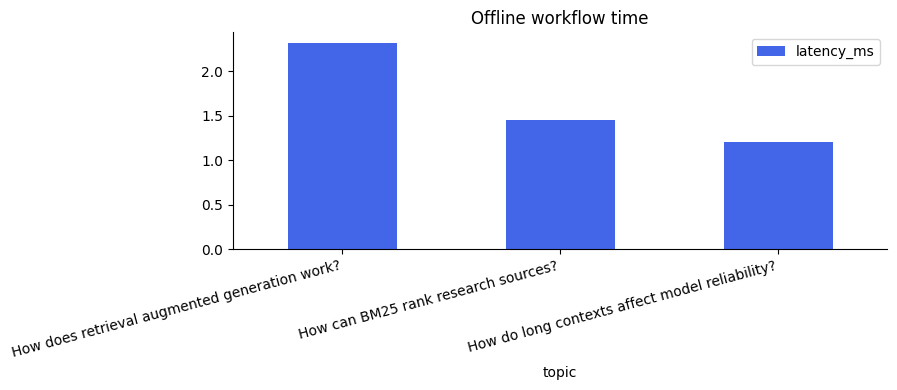
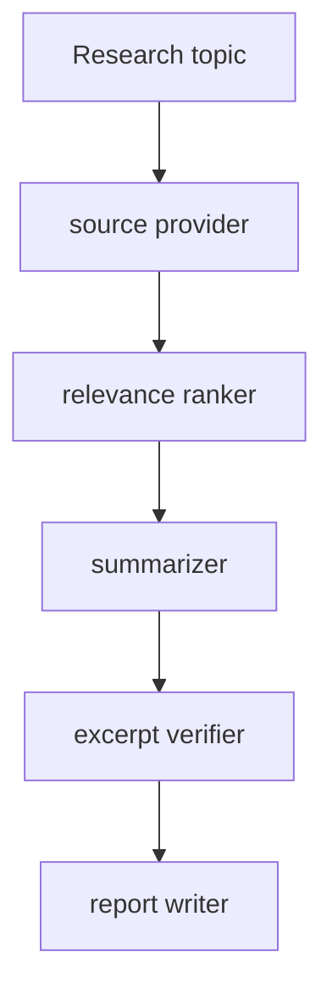

# Atlas Research

A bounded multi-stage research assistant that retrieves sources, ranks evidence, summarizes findings, validates citation excerpts, and exports a traceable report.



**LangGraph orchestration · TF-IDF retrieval · optional OpenAI web search · SQLite report history**

## What it does

- Five explicit LangGraph nodes with duration traces and bounded execution.
- Offline mode runs without credentials using a clearly labelled fixed retrieval/AI corpus.
- Live mode uses OpenAI web search and an LLM summary over provider-cited excerpts.
- Live mode adds a separate LLM entailment review after deterministic excerpt validation. This is a conservative second pass, not a guarantee of truth.
- Verifier rejects nonexistent source IDs and quotations absent from source records.
- Dashboard includes source provenance, recent investigations and Markdown export.
- Notebook measures workflow timing and adversarial citation-integrity checks.

## Run locally

Requires Python 3.12+. Run each project in its own virtual environment.

```bash
git clone https://github.com/Izu-kun23/atlas-research.git
cd atlas-research
python -m venv .venv
source .venv/bin/activate
# Windows PowerShell: .venv\Scripts\Activate.ps1
python -m pip install -r requirements.txt
python -m uvicorn app.main:app --host 127.0.0.1 --port 8001
```

Open **http://localhost:8001**. Interactive OpenAPI documentation: **http://localhost:8001/docs**. No Node build, CDN, cloud database or frontend keys required. The responsive frontend uses semantic HTML, local CSS and browser JavaScript, served from the same origin as the API.

## Architecture



```text
app/
  domain/          Pure data contracts and algorithms
  services/        Application workflows and model orchestration
  infrastructure/ External providers and persistence adapters
  web/             Responsive dashboard and API client
  main.py          HTTP composition root and validation
data/              Reproducible demo corpus or local runtime storage
notebooks/         Executable analysis with saved outputs
tests/             Domain and API regression tests
```

HTTP routes validate inputs and delegate to services. Domain code contains the core rules. Infrastructure handles persistence and external providers. The same functions power notebooks and the application, preventing separate analysis and serving implementations.

## API

`GET /api/config`, `GET /api/reports`, `POST /api/research` (`{"topic":"How does retrieval improve research?"}`), `GET /api/reports/{id}`, `GET /api/reports/{id}/download`

All endpoints are documented and callable in `/docs`. Errors use standard FastAPI status codes and a `detail` payload. `GET /api/health` is available for health checks.

## Notebook and verification

```bash
python -m pip install -r requirements.lock
python -m pytest -q
# Optional DOM interaction checks (Node 24+)
npm ci
npm run test:ui
python -m pip install jupyterlab
python -m jupyter lab notebooks
```

Open the notebook and choose **Run All**. Checked-in outputs are generated from real executions on bundled data, not hand-entered results. See [verification](docs/verification.md) for measured outcomes and scope.

## Configuration and limitations

Default: `RESEARCH_MODE=demo`. For live research, set `RESEARCH_MODE=live`, `OPENAI_API_KEY`, and optionally `OPENAI_MODEL` in your shell. The application does **not** automatically load `.env`; use `uvicorn --env-file .env` with `python-dotenv` installed, or export variables. API usage incurs provider charges. No browser-side keys.

The local retrieval layer uses sparse TF-IDF, not an embedding database. The specialized agents are bounded processing roles in a graph, not autonomous agents with arbitrary tools. Demo findings are extractive paraphrases. Live evidence consists of provider-cited excerpts, not independently downloaded documents. Exact quote validation establishes provenance, not semantic entailment or factual truth. Small excerpts can omit context. No fake confidence score is presented.

Local persistence lives in `data/`; runtime database/model files and secrets are excluded from git. Configuration variables are described in `.env.example`.

## Docker

```bash
docker build -t atlas-research .
docker run --rm -p 8001:8000 atlas-research
```

The container runs as a non-root user. Data is ephemeral unless a writable volume is mounted at `/app/data`. Pass explicit `-e` variables for optional providers.

## Deployment boundary

This is a functioning local portfolio application, not a multi-tenant production service. There is no authentication or per-user isolation. Keep the default localhost binding; add authentication, rate limiting, request budgets, TLS, structured observability and an egress policy before public deployment. External API usage should have spend limits. Notebook results are small-data evidence, not production benchmarks.

## Design and implementation

The UI includes responsive layouts, accessible form labels, loading/error states, empty states, keyboard-focus styles and safe rendering of source/user content. No analytics tracker or external font request is required.

## License

MIT · Izuchukwu Tony
